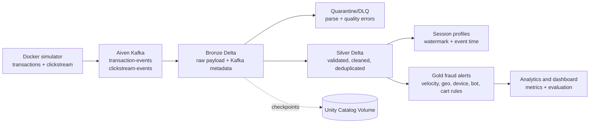

# FraudStream — Kafka-to-Databricks Fraud Detection Streaming Platform

[](https://www.python.org/) [](https://aiven.io/kafka) [](https://spark.apache.org/) [](https://www.databricks.com/) [](https://www.docker.com/)

FraudStream is a portfolio data engineering project that simulates financial
transactions and web clickstream events, publishes them to Aiven Kafka, and
processes them with Spark Structured Streaming on Databricks. It uses a
Bronze/Silver/Gold lakehouse design and produces explainable, rule-based fraud
alerts.

> **Scope:** this is a reproducible demo using synthetic data and business
> rules. It is not a trained machine-learning model or a production payment
> decision system.

## Architecture



| Mode | Behavior | Use |
|---|---|---|
| `BATCH` | Finite `availableNow` micro-batches | Demo, backfill, smoke test |
| `STREAMING` | Long-running `processingTime` queries on classic job compute | Production-oriented deployment |

Databricks Free Edition Serverless may restrict workloads to incremental
`availableNow` runs. For always-on processing, use a classic Databricks job
cluster. The DLT file is optional and consumes existing Bronze data; it is not
an independent Kafka source.

## Business value

Fraud teams need behavioral context around payment events. FraudStream shows
how a platform can ingest two event domains, preserve raw evidence, quarantine
bad records, enrich transactions with session behavior, produce explainable
alerts, and expose throughput, offsets, quality, and evaluation metrics.

## Challenges and solutions

| Challenge | Solution |
|---|---|
| Kafka credentials and TLS must not enter Git | Databricks Secret Scope for the password, Unity Catalog Volume for the CA PEM, SASL_SSL at runtime |
| Bad JSON, missing fields, duplicates, and late events | Raw Bronze retention, rejection reasons, quarantine tables, event-time watermarking, and deduplication |
| Mixed timestamp formats | Safe `try_to_timestamp` parsing; malformed values go to quarantine |
| Reruns can duplicate alerts | Gold `MERGE` keyed by `transaction_id` and stable checkpoints |
| Serverless rejects cluster-level settings | Serverless-compatible defaults and a documented classic-cluster path |
| Rules need behavioral context | Session profiles join clickstream activity to transaction scoring |
| Synthetic labels can mislead metrics | Metrics are labelled as rule-based evaluation on synthetic data |

## Technology choices

| Technology | Why it is used |
|---|---|
| Aiven Kafka | Managed Kafka with TLS/SASL, topics, partitions, and offsets |
| Spark Structured Streaming | Distributed event-time processing, watermarks, checkpoints, and Delta sinks |
| Databricks | Managed Spark, Unity Catalog, Delta Lake, notebooks, and orchestration |
| Delta Lake | ACID tables, replayable layers, schema evolution, and idempotent merges |
| Docker Compose | Reproducible simulator runtime with minimal local setup |
| Python package + notebooks | Shared transformations remain testable; notebooks stay orchestration-focused |

## Quick start

### Prerequisites

- Git
- Docker Desktop
- Aiven Kafka with `transaction-events` and `clickstream-events` topics
- A Databricks workspace for Spark processing

### 1. Clone and configure the simulator

```powershell
git clone https://github.com/imisseva/fraudstream.git
cd fraudstream
Copy-Item .env.example .env
```

Fill `.env` with Aiven settings. Put the Aiven CA certificate at `ca.pem` in
the project root. `.env` and `ca.pem` are ignored by Git and must never be
committed.

### 2. Start the producer

```powershell
docker compose up -d --build
docker compose logs -f simulator
```

Stop it with:

```powershell
docker compose down
```

Lower `RATE` in `.env` or use `--max-events` for a small smoke test.

## Databricks setup

Create a Secret Scope containing only the Kafka password:

```text
Scope: fraudstream
Key: aiven-kafka-password
```

Create the checkpoint volume:

```sql
CREATE VOLUME IF NOT EXISTS workspace.default.fraud_checkpoints;
```

Upload `ca.pem` to:

```text
/Volumes/workspace/default/fraud_checkpoints/ca.pem
```

The password is read at runtime with `dbutils.secrets.get`; credentials are
not stored in notebooks, job parameters, or Git.

### Batch run

1. Add this repository as a Databricks Git Folder.
2. Open `notebooks/00_run_all_pipeline.py`.
3. Set `run_mode=BATCH`.
4. Run all cells.

The batch DAG is:

```text
01 ingestion → 02 quality → 03 fraud detection → 04 analytics
```

Check the results:

```sql
SELECT COUNT(*) FROM workspace.default.bronze_transactions;
SELECT COUNT(*) FROM workspace.default.silver_transactions;
SELECT COUNT(*) FROM workspace.default.gold_fraud_alerts;
SELECT COUNT(*) FROM workspace.default.quarantine_transactions;
```

### Streaming run

Stop any batch run first. Open `notebooks/05_fraudstream_continuous.py` and
set `run_mode=STREAMING`. On classic job compute it uses stable checkpoints and
`processingTime` triggers. Stop and restart the job to verify offset resume.

```sql
SELECT *
FROM workspace.default.fraudstream_pipeline_metrics
ORDER BY recorded_at DESC
LIMIT 20;
```

Never run batch and streaming simultaneously against the same topics, tables,
or checkpoints.

## Testing

```powershell
python -m pip install -e ".[dev]"
python -m pytest tests/ -v
```

Enable the external Kafka test only when credentials are available:

```powershell
$env:KAFKA_INTEGRATION = "1"
python -m pytest tests/test_kafka_integration.py -v
```

## Deployment

The preferred deployment is Databricks Asset Bundles:

```powershell
databricks bundle validate -t dev `
  --var="workspace_host=https://<workspace-host>" `
  --var="existing_cluster_id=<cluster-id>" `
  --var="notification_email=<email>" `
  --var="job_owner_group=<workspace-group>"

databricks bundle deploy -t dev `
  --var="workspace_host=https://<workspace-host>" `
  --var="existing_cluster_id=<cluster-id>" `
  --var="notification_email=<email>" `
  --var="job_owner_group=<workspace-group>"
```

The JSON under `workflows/` is retained only for legacy manual import;
`resources/` and `databricks.yml` are the primary deployment path.

## Project structure

```text
src/fraudstream/       Shared Spark transformations, Kafka config, metrics
notebooks/              Databricks batch, streaming, and analytics orchestration
simulator/              Synthetic generators and Aiven Kafka producer
pipelines/              Optional DLT example consuming existing Bronze tables
tests/                  Unit, contract, workflow, and integration tests
conf/                   Environment templates
docs/                   Architecture and operations runbook
resources/              Databricks Asset Bundle job definitions
```

## Limitations

Fraud scoring is rule-based and evaluated on synthetic labels. Free Edition
is suitable for a reproducible demo but does not provide production SLA,
always-on classic compute, or full operational guarantees. Production use
should add a governed Databricks workspace, service principals, schema registry,
Kafka-lag alerting, load tests, and incident runbooks.
